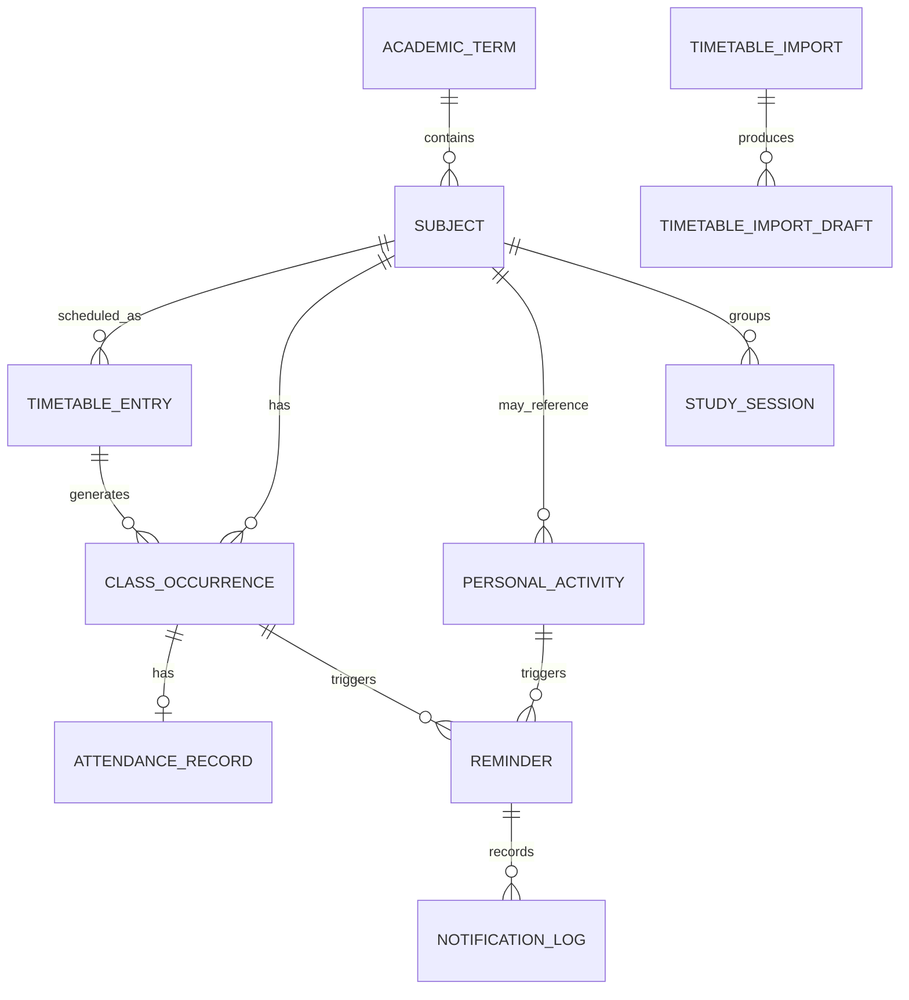

# TimeWise — Complete Project Blueprint

**Project name:** TimeWise  
**Full name:** AI-Powered Academic Timetable, Attendance & Personal Productivity Assistant  
**Project type:** Personal academic productivity system  
**Primary interface:** Command-line interface (CLI)  
**Initial development language:** Python  
**Architecture:** Object-oriented, modular, local-first, progressively database-backed  
**Long-term direction:** AI-enabled, data-driven, tested, documented, industry-oriented software project  
**GUI constraint:** No Tkinter, Streamlit, desktop dashboard, or web front end. OS notifications are allowed because they are alerts, not an application GUI.

> **Project philosophy:** Build a useful working Python application now, then improve the same codebase as new programming, database, data-analysis, AI and ML concepts are learned. Do not add technologies merely to make the project look advanced.

---

# 1. Executive summary

TimeWise is a personal academic assistant that combines a student's college timetable, attendance records, personal study schedule, reminders and learning analytics in one system.

A student can provide a photograph or screenshot of a college timetable. TimeWise will process the image, extract possible timetable information, convert it into structured records and ask the student to review and confirm the results. Once confirmed, the timetable becomes usable for daily and weekly planning.

TimeWise will also allow the student to:

- Manage college subjects, recurring lectures, rooms and faculty details.
- Track attendance for each actual class occurrence.
- Calculate subject-wise and overall attendance.
- Calculate how many future classes should be attended to reach a target attendance percentage.
- Estimate how many additional classes could be missed while staying above a configured target, with clear assumptions.
- Create personal activities such as Python study, DSA practice, revision, exercise and appointments.
- Receive reminders before college classes and personal activities.
- Detect overlapping activities and timetable conflicts.
- Review daily, weekly, monthly and semester-level reports.
- Analyse study habits and attendance patterns using historical data.
- Eventually use OCR, document understanding and carefully evaluated ML models to provide more intelligent assistance.

The initial version will be a CLI application. It will not require a GUI. The first version will use manually entered sample data and in-memory objects. Image processing, persistent storage, databases, analytics and ML will be introduced in later development phases as the relevant concepts are learned.

# 2. The problem TimeWise solves

Students often manage academic information in several disconnected places:

- College timetable photographs, PDFs or notices.
- Notes or spreadsheets containing attendance.
- A calendar or notebook for personal study plans.
- Separate reminders for lectures, assignments and revision.
- Manual calculations to understand attendance percentages.

This creates several problems:

1. **Manual timetable entry is tedious.** A student may need to type every subject, day, time and room from a timetable image.
2. **Schedule changes are easy to miss.** A revised timetable, room change, holiday or cancelled lecture may make an old schedule inaccurate.
3. **Attendance calculations take effort.** Students may not know their current subject-wise percentage or what will happen if they miss future classes.
4. **College and personal schedules are disconnected.** Students may plan study sessions without considering their actual lecture schedule.
5. **Reminders are fragmented.** A student may miss a class, study session, deadline or revision task.
6. **There is little analysis of personal habits.** Students may not know which subjects consume the most time or whether their planned study routine is realistic.

TimeWise aims to bring these workflows together while keeping the student in control of the data and decisions.

# 3. Target users and primary use case

## 3.1 Initial user

The first user is the project owner: a college student who wants to manage their own college timetable, attendance and personal study routine.

## 3.2 Future users

The architecture may later support other students, but multi-user accounts, synchronization and deployment are not required for the first version.

## 3.3 Primary user journey

1. Start TimeWise from the terminal.
2. Create an academic term and add subjects, or import a timetable image.
3. Review the timetable entries extracted from the image.
4. Correct any subject, day, time, room or faculty mistakes.
5. Confirm the timetable and choose the attendance policy that applies to the course or subject.
6. View today's or this week's schedule.
7. Receive a reminder before a lecture or personal activity.
8. After a lecture, mark the actual class occurrence as present, absent, late or cancelled as appropriate.
9. View attendance percentages and reports.
10. Add personal learning activities and compare planned study time with actual study sessions.

# 4. Product principles and important boundaries

## 4.1 Human review for timetable image extraction

An image model or OCR engine can misread small text, handwritten text, merged cells, abbreviations or low-quality photographs. Therefore, image extraction must create a **draft**, not silently create a final timetable.

The workflow must be:

**Upload image → preprocess → OCR/layout extraction → parse fields → validate → show draft and confidence → user corrects → user confirms → save timetable.**

The student remains responsible for confirming that the timetable is correct.

## 4.2 Attendance must be based on actual class occurrences

A recurring timetable entry is a template, not proof that a lecture actually happened. Attendance must be recorded against a dated class occurrence.

For example, “Database Systems every Monday at 10:00” is a recurring timetable rule. “Database Systems on Monday, 9 November 2026 at 10:00” is an actual occurrence. The attendance record belongs to the dated occurrence.

This distinction is essential for holidays, cancelled lectures, extra classes, rescheduled lectures and timetable changes.

## 4.3 Attendance rules are configurable

Do not hard-code 75% as a universal requirement. The student must enter the attendance requirement specified by their institution, course or subject. The app should clearly identify the source and effective date of that policy if the student enters them.

A cancelled class or a day when no class took place should not automatically count as an absence. The denominator must follow the user's institution's attendance rules.

## 4.4 TimeWise does not automatically know whether a student attended

In the first versions, the student manually marks attendance. Automatic attendance import or integration with a college portal is a future, permission-dependent feature. Do not scrape restricted systems or claim that attendance has been verified when it has not.

## 4.5 Local-first and privacy-conscious

The initial design should keep timetable images and personal records on the student's computer. If a later OCR or AI provider requires uploading an image to a third-party service, the app must clearly disclose that and obtain the user's choice. API keys and passwords must never be committed to GitHub.

## 4.6 No GUI

The application is operated through terminal commands or a terminal menu. Image import can accept a local file path. Later, an API can accept an uploaded file without requiring a graphical front end.

# 5. Existing applications and TimeWise's proposed positioning

Student planner products already offer many overlapping features. For example:

- MyStudyLife describes class timetables, reminders, homework, exams, timetable-photo scanning, rotating schedules and AI planning: <https://mystudylife.com/tour/> and <https://mystudylife.com/>.
- Schedo describes photo-based timetable creation and attendance/bunk analytics: <https://play.google.com/store/apps/details?id=com.jhainusa.jss_student>.
- ClassTrack describes timetable extraction from a photo or PDF, attendance features and an AI study assistant: <https://classtracks.app/>.

Therefore, TimeWise should **not** claim that timetable scanning, reminders or attendance calculations are new features.

Its portfolio differentiation should be demonstrated through the quality and transparency of its implementation:

1. **Inspectable extraction:** retain the original import, extracted text/fields, confidence information, validation warnings and user corrections.
2. **Review-before-save workflow:** uncertain timetable entries are never silently accepted.
3. **Occurrence-based attendance model:** distinguish recurring timetable rules from individual conducted/cancelled classes and attendance records.
4. **Explainable attendance forecasts:** show the arithmetic, assumptions and policy used for every projection.
5. **Unified college and personal planning:** account for lectures when suggesting personal study periods.
6. **Data-analysis layer:** expose useful trends, not just a percentage on a screen.
7. **Evaluated AI components:** measure timetable extraction quality on labelled examples and compare ML models against simple baselines.
8. **Portfolio-quality engineering:** modular design, tests, data validation, logs, migrations, documentation, reproducible setup and responsible handling of private data.

This is a proposed engineering and product focus, not a claim that no existing product has similar functionality.

# 6. Scope by version

## 6.1 Version 1 — OOP foundation

Build a working CLI application using concepts already learned:

- Create, list, edit and delete personal activities.
- Add manually entered college timetable entries.
- View a daily timetable and a weekly timetable.
- Detect overlapping activities.
- Represent activities and classes as objects.
- Use object composition and clear class responsibilities.
- Use a console notifier or a simulated reminder check.
- Store data in memory only.

**Not included yet:** image OCR, database, ML, web API, complex background scheduling or cloud sync.

## 6.2 Version 2 — Complete scheduling rules

- One-time, daily and selected-weekday recurrence.
- Effective start/end dates for recurring entries.
- Timetable exceptions for holidays, cancelled classes and extra classes.
- Reminder lead-time settings.
- Reminder de-duplication and snoozing.
- More complete conflict detection.
- Correct handling of dates and times.

## 6.3 Version 3 — File handling and timetable import foundation

- JSON export/import and backup/restore.
- Store an original timetable image with metadata.
- Add a manual draft-entry review workflow.
- Define a timetable-import data format independent of the OCR provider.
- Add validation for imported timetable records.

At this stage the image may be stored and associated with a manually entered draft. Automatic image recognition is added only after the required image-processing/OCR learning.

## 6.4 Version 4 — Attendance management

- Generate dated class occurrences from recurring timetable entries.
- Mark occurrences present, absent, late, cancelled or not held.
- Handle extra classes and rescheduled classes.
- Calculate attendance per subject and for the overall term.
- Configure attendance targets per subject or course.
- Calculate future attendance scenarios.
- Keep a correction history for attendance changes.

## 6.5 Version 5 — Database-backed application

- Move from JSON/in-memory storage to SQLite.
- Use SQLAlchemy models and relationships.
- Add database transactions, constraints and indexes.
- Add schema migrations when the data model changes.
- Add database backup and restore.

## 6.6 Version 6 — Real timetable image analysis

- Accept JPG, JPEG and PNG images initially; PDF import can follow.
- Validate file type, size and image readability.
- Correct orientation and perform image preprocessing.
- Apply OCR to detect text.
- Identify table structure, rows, columns, day labels, time slots and merged cells.
- Parse possible subjects, times, rooms, faculty and weekday patterns.
- Normalize abbreviations and time formats.
- Assign confidence or validation status to extracted fields.
- Present an editable draft for confirmation.
- Save extraction results and corrections for evaluation.

## 6.7 Version 7 — Data analysis and intelligent recommendations

- Subject-wise and term-wise attendance analytics.
- Weekly/monthly study-time analytics.
- Planned versus actual study-time comparisons.
- Day-of-week and time-of-day patterns.
- Attendance and study trend reports.
- Rule-based study-slot recommendations.
- Optional ML experiments after sufficient quality data has been collected.

## 6.8 Version 8 — Professional API and reliability

- Flask REST API.
- API request/response validation.
- Authentication and authorization if multi-user access is introduced.
- Asynchronous or reliable scheduled reminder processing where appropriate.
- Logging, configuration, automated tests and CI.
- Packaging, installation instructions and operational documentation.

## 6.9 Version 9 — Industry-oriented release

- Security and privacy review.
- Robust data migrations and backups.
- Error handling and recovery procedures.
- Performance testing and profiling.
- OCR and ML evaluation reports.
- API documentation.
- Versioned releases and changelog.
- User feedback and usability improvements.
- Reproducible development and deployment instructions.

# 7. Functional requirements

The following requirements describe the complete intended product. They will be implemented incrementally, not all in Version 1.

## 7.1 Student, term and subject management

| ID | Functionality | Description |
|---|---|---|
| FR-001 | Create profile | Store a local user profile and preferred time settings. |
| FR-002 | Manage academic terms | Add term name, start date, end date and institution details if desired. |
| FR-003 | Manage subjects | Add, view, edit and archive subjects. |
| FR-004 | Subject metadata | Store subject code, name, faculty, room defaults and attendance target where applicable. |
| FR-005 | Subject groups | Optionally group subjects by semester, department or course. |

## 7.2 Timetable image import and analysis

| ID | Functionality | Description |
|---|---|---|
| FR-010 | Import timetable image | Accept a local image path through the CLI. |
| FR-011 | Validate file | Check supported type, readable content and allowed file size. |
| FR-012 | Preserve original | Store the original file or a safe local copy and its metadata. |
| FR-013 | Preprocess image | Correct orientation, crop, resize, improve contrast and reduce noise where useful. |
| FR-014 | OCR extraction | Extract text from the image. |
| FR-015 | Table interpretation | Identify timetable rows, columns, headings, merged cells and time slots. |
| FR-016 | Field extraction | Identify subject, weekday, start time, end time, room, faculty and optional batch/group. |
| FR-017 | Normalize fields | Convert recognized times, weekday names and subject labels into consistent values. |
| FR-018 | Confidence and warnings | Flag uncertain or incomplete fields and possible conflicts. |
| FR-019 | Review draft | Show extracted records for user correction. |
| FR-020 | Confirm import | Save only after user confirmation. |
| FR-021 | Re-import/versioning | Keep a record when a timetable is replaced or updated. |
| FR-022 | Import evaluation | Compare extracted fields with manually labelled ground truth during development. |

## 7.3 College timetable management

| ID | Functionality | Description |
|---|---|---|
| FR-030 | Add timetable entry | Manually create a recurring college class. |
| FR-031 | Edit timetable entry | Change subject, day, time, room, faculty or recurrence. |
| FR-032 | Delete/archive entry | Remove or archive an outdated entry without corrupting old attendance history. |
| FR-033 | Daily timetable | Display classes and personal activities for a selected date. |
| FR-034 | Weekly timetable | Display the seven-day schedule. |
| FR-035 | Sort schedule | Sort items by date and start time. |
| FR-036 | Detect overlaps | Identify intersecting time ranges. |
| FR-037 | Timetable exceptions | Add holidays, cancelled classes, extra classes and rescheduled classes. |
| FR-038 | Effective dates | Limit recurring timetable entries to the correct semester/date range. |
| FR-039 | Rotating timetable extension | Support A/B weeks or other rotation patterns in a later version. |

## 7.4 Personal activity and study planning

| ID | Functionality | Description |
|---|---|---|
| FR-040 | Add personal activity | Add study, revision, exercise, appointment or another activity. |
| FR-041 | Recurrence | Create one-time, daily or selected-weekday activities. |
| FR-042 | Activity priority | Set a priority such as low, normal or high. |
| FR-043 | Activity status | Mark planned, completed, skipped or postponed. |
| FR-044 | Edit/delete activity | Update or remove a personal activity. |
| FR-045 | Free-time finder | Identify gaps between scheduled commitments. |
| FR-046 | Study session log | Record actual time spent on a study activity. |
| FR-047 | Planned versus actual | Compare scheduled study time with logged time. |

## 7.5 Attendance management

| ID | Functionality | Description |
|---|---|---|
| FR-050 | Generate class occurrences | Create dated instances from recurring timetable entries. |
| FR-051 | Mark attendance | Mark an occurrence present, absent, late, cancelled or not held. |
| FR-052 | Correct attendance | Allow correction with a reason and timestamp. |
| FR-053 | Subject attendance | Calculate attendance per subject. |
| FR-054 | Overall attendance | Calculate aggregate attendance using the selected counting policy. |
| FR-055 | Attendance target | Configure target percentage; never assume one universal rule. |
| FR-056 | Classes needed | Calculate how many future classes must be attended to reach the target. |
| FR-057 | Absence allowance | Estimate additional absences permitted while remaining at/above the target, with assumptions shown. |
| FR-058 | Scenario analysis | Compare outcomes such as attending all future classes or missing selected future classes. |
| FR-059 | Attendance trends | Show changes over days, weeks and the term. |
| FR-060 | Attendance export | Export a subject-wise attendance report. |

## 7.6 Reminder and notification system

| ID | Functionality | Description |
|---|---|---|
| FR-070 | Reminder settings | Configure default and per-activity reminder lead times. |
| FR-071 | Pre-event reminder | Notify before a college class or personal activity. |
| FR-072 | Start-time reminder | Optionally notify when an activity starts. |
| FR-073 | Snooze | Postpone a reminder by a chosen interval. |
| FR-074 | De-duplication | Do not send the same reminder repeatedly for one occurrence. |
| FR-075 | Notification history | Record when a reminder was scheduled, sent, snoozed or failed. |
| FR-076 | Console notification | Display reminders in the terminal. |
| FR-077 | Desktop notification | Add an OS notification provider in a later phase. |
| FR-078 | Background operation | Add reliable background startup/scheduling only after the core reminder logic works. |

## 7.7 Data analytics and reporting

| ID | Functionality | Description |
|---|---|---|
| FR-080 | Daily report | Summarize today's classes, activities and completion status. |
| FR-081 | Weekly report | Summarize attendance and study time for the week. |
| FR-082 | Subject report | Show attendance and study effort by subject. |
| FR-083 | Monthly/term report | Show longer-term patterns. |
| FR-084 | Study-time analysis | Compare time spent across subjects and activity types. |
| FR-085 | Schedule utilization | Estimate how much planned time was completed. |
| FR-086 | Data export | Export appropriate reports to CSV/JSON. |
| FR-087 | Data quality report | Identify missing attendance records, duplicate classes and inconsistent timetable data. |

## 7.8 AI and ML extensions

| ID | Functionality | Description |
|---|---|---|
| FR-090 | OCR pipeline | Convert timetable image content into text and structured fields. |
| FR-091 | Extraction quality evaluation | Measure field-level extraction accuracy on labelled examples. |
| FR-092 | Subject normalization | Match abbreviations or inconsistent subject spellings to known subjects. |
| FR-093 | Study recommendations | Recommend feasible study slots using schedule constraints and historical behaviour. |
| FR-094 | Attendance risk experiment | Estimate the risk of falling below a configured attendance target, only when enough reliable history exists. |
| FR-095 | Recommendation explanation | Explain which schedule or historical factors influenced a recommendation. |

# 8. Attendance calculation rules

Attendance calculations must be transparent and testable.

Let:

- `P` = number of attended classes counted under the selected policy.
- `H` = number of eligible classes held and counted under the selected policy.
- `T` = target attendance fraction, for example `0.75` for a 75% target.

Current attendance:

`attendance_percentage = (P / H) * 100`

If `H = 0`, show “No attendance data yet” rather than dividing by zero or reporting 0%.

## 8.1 Classes required to reach a target

If the student attends every future class, the minimum number of additional classes needed to reach target `T`, where `0 < T < 1`, is:

`x = ceil((T * H - P) / (1 - T))`

If the result is negative, use zero. If the target is 100% and the student already has any absences, attending future classes alone cannot mathematically erase those absences; explain that limitation.

## 8.2 Maximum additional consecutive absences while staying at target

Under the simplified assumption that each future absence adds one eligible held class and does not add an attended class:

`max_absences = floor((P / T) - H)`

Clamp the displayed allowance to zero or more. If the student is already below target, show zero additional absences and separately state that the current percentage is below target.

These formulas are planning estimates. They must be adapted if an institution uses lecture hours, credits, practical/theory weighting, condonation, different denominator rules or other attendance policies.

## 8.3 Status counting policy

The application must make the policy explicit. A sensible configurable starting policy is:

- `PRESENT`: adds one to attended and held counts.
- `ABSENT`: adds one to held count only.
- `LATE`: count as attended, absent or fractional only according to the configured institution rule.
- `CANCELLED`: excluded from held count.
- `NOT_HELD`: excluded from held count.
- `PENDING/UNMARKED`: not silently treated as present or absent; display as an incomplete record until reconciled.

Do not calculate a final attendance figure by treating every future scheduled timetable entry as a conducted class.

# 9. Timetable image analysis design

This is a major AI engineering component, but it will be built only after the basic scheduling and data models are stable.

## 9.1 Input types

Initial target:

- JPG/JPEG photographs.
- PNG screenshots.

Possible later support:

- PDF timetable documents.
- Scanned PDFs.
- Multiple-page timetables.
- Rotating or A/B week timetables.
- Handwritten schedules, if quality can be evaluated adequately.

## 9.2 Proposed processing pipeline

1. **File intake:** accept a local path or, later, an API upload.
2. **File validation:** verify extension, actual content, size and readability.
3. **Image preprocessing:** correct rotation, crop irrelevant margins, resize, adjust contrast and reduce noise.
4. **OCR:** identify text and its approximate bounding boxes.
5. **Layout analysis:** identify table boundaries, rows, columns, day headings, time headings and merged cells.
6. **Field parsing:** map recognized text to subject, weekday, time, room, faculty and batch.
7. **Normalization:** standardize day names, subject aliases and time formats.
8. **Validation:** check missing values, invalid times, duplicate entries and overlapping extracted classes.
9. **Confidence scoring:** retain OCR confidence where available and add parser/validation confidence or warning levels.
10. **Human review:** display a draft that the student can edit.
11. **Confirmation:** save confirmed timetable entries and preserve import provenance.
12. **Evaluation:** compare extraction results with manually labelled reference records.

## 9.3 Why human review is required

A timetable can contain merged cells, short subject codes, small fonts, low-resolution photos or handwritten annotations. OCR can read characters incorrectly, and reading text alone does not necessarily reveal which table cell the text belongs to. A wrong subject or time could cause missed lectures or incorrect attendance records.

TimeWise must make uncertainty visible and let the user correct the extracted information before it affects reminders or attendance.

## 9.4 OCR evaluation

Create a small labelled evaluation dataset of timetable images and manually verified expected records. Do not evaluate only whether the OCR text looks plausible.

Measure at least:

- Subject-name exact-match accuracy.
- Weekday extraction accuracy.
- Start-time and end-time exact-match accuracy.
- Room/faculty extraction accuracy where those fields exist.
- Complete timetable-entry accuracy.
- Character Error Rate (CER) for raw text, when appropriate.
- Human correction rate: how often the user must change extracted fields.

Split evaluation data by source timetable/document, not by randomly separating near-identical crops from one image into both training and test sets.

# 10. Data analysis and ML roadmap

TimeWise is intended to support an AI engineering learning path, but not every feature should use ML. Prefer a simple, explainable rule when it solves the problem reliably.

## 10.1 Data analysis

Once reliable records exist, analyse:

- Attendance percentage by subject and by week.
- Present/absent/late/cancelled counts.
- Attendance changes during a term.
- Planned versus completed personal study time.
- Study minutes per subject.
- Which days have the most scheduled activity.
- Which time windows are consistently used or missed.
- Frequency of timetable conflicts and schedule changes.
- OCR correction patterns, such as commonly confused subject abbreviations or time characters.

Possible tools after learning the relevant concepts:

- Python collections and built-in statistics for early reports.
- CSV and JSON for export.
- NumPy for numerical operations when useful.
- pandas for tabular analysis and aggregation.
- Matplotlib for charts saved as image files or included in reports; no GUI dashboard is required.

## 10.2 Rule-based recommendations before ML

Start with transparent rules. Example: if a student has a free 60-minute interval on Tuesday and has scheduled less than their chosen study target for DSA, TimeWise can suggest that slot.

The recommendation should respect:

- College class times.
- Existing personal commitments.
- Minimum break preferences.
- User-selected study hours.
- Optional preferred time-of-day settings.

This is an optimization/rule-based feature, not ML. It gives us a baseline to compare with later approaches.

## 10.3 ML experiments

Potential ML tasks after data collection:

1. **Attendance risk classification:** estimate whether a subject may fall below a configured attendance target by the end of the term.
2. **Study-slot preference prediction:** estimate which available study windows the user is more likely to complete, based on historical behaviour.
3. **Subject/label normalization:** experiment with text similarity to match abbreviations and inconsistent subject names.
4. **Timetable extraction:** compare OCR-only, rule-based parsing and later document-understanding models.

Do not train a predictive model on a tiny or unreliable dataset and present its output as trustworthy. Begin with rules, collect enough representative data, create a baseline, use an appropriate time-based validation strategy, and report the model's limitations.

For an attendance risk model, possible features include current attendance ratio, total held classes, absences in recent weeks, remaining scheduled classes and historical attendance trend. Do not include future information that would leak the answer into training data.

Possible evaluation metrics:

- Precision and recall for risk detection.
- F1 score where appropriate.
- Confusion matrix.
- Calibration or probability reliability.
- Comparison with a simple rule-based baseline.

An ML prediction must be advisory and explainable. It must never replace the official attendance record or institution policy.

# 11. Proposed technology stack, introduced progressively

| Area | Initial approach | Later approach |
|---|---|---|
| Language | Python | Python with type hints and stronger architecture |
| Interface | CLI menu | CLI with `argparse`; optional API client commands |
| OOP | Classes, objects, composition | Interfaces/ABCs, dependency injection and clear service boundaries |
| Date/time | `datetime` | Time-zone-aware scheduling and more robust recurrence handling |
| Initial storage | In-memory objects | JSON for learning, then SQLite |
| Database | None | SQLite + SQLAlchemy + migrations |
| Validation | Explicit Python validation | Pydantic at external/import boundaries |
| Testing | Manual examples | pytest, fixtures, parametrized and integration tests |
| Image input | File path handling | Pillow/OpenCV preprocessing as needed |
| OCR | Not in Version 1 | Evaluate an OCR engine such as Tesseract, EasyOCR or PaddleOCR against real timetable samples |
| Data analysis | Built-in Python | pandas, NumPy and Matplotlib |
| ML | Deterministic rules | scikit-learn experiments; model evaluation and reproducibility |
| API | None | Flask REST API |
| HTTP integration | None | `requests` for external services where appropriate |
| Background work | Foreground reminder check | Reliable scheduler/process design; `asyncio` only where concurrency is useful |
| Logging | Basic output | Python `logging`, structured context and log rotation as needed |
| Configuration | Simple defaults | Environment-based configuration; secrets kept outside source control |
| Packaging | Run Python module | Installable package and documented setup |

The exact OCR library and desktop-notification package should be selected when we reach that phase, after checking current compatibility with the Python version and operating system.

# 12. OOP domain model and class responsibilities

The earlier idea of using one generic `Activity` class for absolutely everything needs a small improvement now that college attendance is part of the product. A recurring timetable template, a personal activity and an actual lecture occurrence have different meanings.

## 12.1 Core entities

### `Subject`

Represents a college subject.

Possible attributes:

- `subject_id`
- `subject_code`
- `name`
- `faculty_name` (optional)
- `default_room` (optional)
- `attendance_target` (optional/configurable)
- `academic_term_id`

Possible methods:

- `update_details()`
- `set_attendance_target()`
- `display_details()`

### `TimetableEntry`

Represents a recurring college timetable rule, not an attendance record.

Possible attributes:

- `entry_id`
- `subject_id`
- `weekday`
- `start_time`
- `end_time`
- `room`
- `faculty_name`
- `effective_from`
- `effective_until`
- `week_pattern` (for future A/B or rotation support)

Possible methods:

- `occurs_on(date)`
- `duration_minutes()`
- `overlaps_with(other_entry)`
- `display_details()`

### `PersonalActivity`

Represents a personal commitment such as Python study, DSA practice, exercise or an appointment.

Possible attributes:

- `activity_id`
- `title`
- `category`
- `start_datetime`
- `end_datetime`
- `recurrence_rule`
- `reminder_minutes`
- `priority`
- `status`

Possible methods:

- `duration_minutes()`
- `occurs_on(date)`
- `reschedule()`
- `mark_completed()`
- `display_details()`

### `ClassOccurrence`

Represents one dated instance of a college lecture generated from a timetable entry or entered as an extra class.

Possible attributes:

- `occurrence_id`
- `timetable_entry_id` (optional for extra classes)
- `subject_id`
- `class_date`
- `start_datetime`
- `end_datetime`
- `room`
- `occurrence_status` (scheduled, held, cancelled, not held, rescheduled)

Possible methods:

- `reschedule()`
- `cancel()`
- `mark_held()`

### `AttendanceRecord`

Records the student's attendance for one actual class occurrence.

Possible attributes:

- `attendance_id`
- `occurrence_id`
- `status`
- `marked_at`
- `updated_at`
- `notes` (optional)

Possible methods:

- `mark_present()`
- `mark_absent()`
- `mark_late()`
- `correct_status()`

### `TimetableImport`

Stores the provenance and state of a timetable image import.

Possible attributes:

- `import_id`
- `original_file_path`
- `file_hash`
- `uploaded_at`
- `ocr_engine_name` (optional)
- `raw_extraction` (optional)
- `review_status`
- `confirmed_at` (optional)

Possible methods:

- `create_draft()`
- `mark_reviewed()`
- `confirm()`

### `Reminder`

Represents a reminder for a particular activity or class occurrence.

Possible attributes:

- `reminder_id`
- `target_type`
- `target_id`
- `remind_at`
- `status`
- `snoozed_until` (optional)
- `sent_at` (optional)

Possible methods:

- `is_due(now)`
- `snooze(minutes)`
- `mark_sent()`

## 12.2 Services

Services coordinate domain objects and application operations.

### `TimetableService`

- `add_timetable_entry()`
- `update_timetable_entry()`
- `delete_timetable_entry()`
- `get_daily_schedule()`
- `get_weekly_schedule()`
- `find_conflicts()`
- `generate_occurrences()`
- `add_schedule_exception()`

### `AttendanceService`

- `mark_attendance()`
- `correct_attendance()`
- `get_subject_attendance()`
- `get_overall_attendance()`
- `classes_needed_to_reach_target()`
- `maximum_additional_absences()`
- `project_attendance_scenario()`

### `TimetableImportService`

- `validate_image()`
- `preprocess_image()`
- `extract_text()`
- `parse_timetable()`
- `normalize_extracted_fields()`
- `validate_draft_entries()`
- `review_import()`
- `confirm_import()`

### `ReminderEngine`

- `get_due_reminders()`
- `check_reminders()`
- `dispatch_reminder()`
- `snooze_reminder()`
- `prevent_duplicate_delivery()`
- `record_delivery_result()`

### `AnalyticsService`

- `build_daily_summary()`
- `build_weekly_summary()`
- `build_subject_attendance_report()`
- `build_study_time_report()`
- `compare_planned_and_actual_study()`
- `build_attendance_trend()`
- `build_data_quality_report()`

### `NotificationService` / notifier interface

- `send_notification(title, message)`

Possible implementations:

- `ConsoleNotifier`
- `DesktopNotifier` (later)
- `EmailNotifier` (optional later, only if genuinely useful)

### `TimeWiseApp`

- `start()`
- `display_menu()`
- `handle_command()`
- `shutdown()`

The application coordinator should not contain all business logic. It should call the appropriate services.

# 13. OOP concepts practised in this project

| Python/OOP concept | Where it will be practised |
|---|---|
| Classes and objects | Subject, TimetableEntry, PersonalActivity and other entities |
| Constructors | Initialize valid domain objects |
| Instance variables | Store data belonging to one object |
| Class variables | Shared configuration or carefully chosen counters |
| Instance methods | Modify or describe one object |
| Class methods | Named constructors or class-level operations when appropriate |
| Static methods | Stateless validation/calculation helpers when appropriate |
| Encapsulation | Protect state and enforce valid transitions |
| Inheritance | Notification providers or carefully chosen common entity behaviour |
| Polymorphism | Call the same notification interface for different providers |
| Abstraction | Define contracts using `ABC` and `@abstractmethod` |
| Method overriding | Implement provider-specific notification behaviour |
| `super()` | Extend parent-class initialization/behaviour |
| Composition | Services use repositories, engines and domain objects |
| Aggregation | A timetable can work with independently managed subject records |
| Object interaction | AttendanceService works with occurrences and records |

Do not force inheritance into the data model where composition is clearer. Good OOP is about responsibility and collaboration, not maximizing the number of classes.

# 14. Database design (later phase)

SQLite is a suitable first database for a personal, local application. SQLAlchemy will be introduced after database fundamentals are learned.

Proposed tables:

| Table | Purpose |
|---|---|
| `academic_terms` | Semester/term dates and metadata |
| `subjects` | Subject details and attendance target |
| `timetable_entries` | Recurring college schedule rules |
| `personal_activities` | Personal schedule items |
| `schedule_exceptions` | Holidays, cancellations, extra classes and changes |
| `class_occurrences` | Dated instances of college classes |
| `attendance_records` | Attendance status for an occurrence |
| `timetable_imports` | Original image metadata and extraction provenance |
| `timetable_import_drafts` | Extracted entries awaiting review/confirmation |
| `reminders` | Reminder schedule and delivery state |
| `notification_logs` | Delivery attempts and errors |
| `study_sessions` | Actual study time logged by the user |
| `settings` | User preferences and attendance-counting policy |

## 14.1 Simplified relationship diagram



The final schema will be refined before database implementation. Foreign keys, uniqueness rules, indexes and deletion behaviour must be designed deliberately.

## 14.2 Data integrity rules

- A class occurrence must reference a valid subject.
- An attendance record must reference one valid occurrence.
- A timetable draft must not become active until reviewed and confirmed.
- A class occurrence should not have multiple active attendance records for the same student.
- Deleting or archiving a timetable template must not erase historical attendance.
- Time ranges must be valid and have end after start for the initial same-day implementation.
- Attendance status changes should be auditable once persistent storage is introduced.

# 15. CLI command design

The application will remain usable without a GUI.

Possible future commands:

```text
timewise --help

timewise subject add

timewise subject list

timewise timetable import "C:\\Users\\Student\\Pictures\\college_timetable.jpg"
timewise timetable review IMPORT_ID
timewise timetable confirm IMPORT_ID
timewise timetable today
timewise timetable week
timewise activity add
timewise activity edit ACTIVITY_ID
timewise activity delete ACTIVITY_ID
timewise attendance mark OCCURRENCE_ID --status present
timewise attendance report

timewise attendance subject SUBJECT_ID

timewise attendance forecast SUBJECT_ID

timewise reminder list
timewise report daily
ntimewise report weekly
```

The first version may use a simple numbered terminal menu. `argparse` will be introduced when that topic is reached.

# 16. Reminder engine design

## 16.1 Initial behaviour

- Default reminder: 5 minutes before the activity/class.
- Per-item reminder settings may override the default later.
- The first implementation prints a reminder in the terminal.
- The reminder process must be running to detect an event in the initial foreground version.

## 16.2 Correctness requirements

- Use date/time values rather than comparing arbitrary time strings.
- Ensure one reminder is not sent repeatedly for the same occurrence and reminder rule.
- Keep the occurrence date in the reminder identity so a recurring class can remind again next week.
- Handle application restarts after persistent storage is added.
- Log delivery attempts and failures.
- Make reminder lead time configurable.
- Support snoozing without creating uncontrolled duplicate reminders.

## 16.3 Later desktop notification support

A desktop notifier can implement the same notification interface as the console notifier. This preserves the reminder engine while changing the delivery mechanism. The exact Windows notification package and startup mechanism will be selected and tested at that development phase.

# 17. Final repository structure (target, not to create all at once)

```text
TimeWise/
├── pyproject.toml
├── README.md
├── LICENSE
├── .gitignore
├── .env.example
│
├── src/
│   └── timewise/
│       ├── __init__.py
│       ├── __main__.py
│       ├── cli/
│       │   ├── __init__.py
│       │   ├── parser.py
│       │   └── commands/
│       ├── domain/
│       │   ├── __init__.py
│       │   ├── subject.py
│       │   ├── timetable_entry.py
│       │   ├── personal_activity.py
│       │   ├── class_occurrence.py
│       │   ├── attendance_record.py
│       │   └── reminder.py
│       ├── services/
│       │   ├── timetable_service.py
│       │   ├── attendance_service.py
│       │   ├── reminder_engine.py
│       │   ├── timetable_import_service.py
│       │   └── analytics_service.py
│       ├── notifications/
│       │   ├── base.py
│       │   ├── console.py
│       │   └── desktop.py
│       ├── repositories/
│       │   ├── interfaces.py
│       │   ├── in_memory.py
│       │   └── sqlalchemy_repository.py
│       ├── database/
│       │   ├── models.py
│       │   ├── session.py
│       │   └── migrations/
│       ├── imports/
│       │   ├── image_validation.py
│       │   ├── preprocessing.py
│       │   ├── ocr.py
│       │   ├── table_parser.py
│       │   └── normalization.py
│       ├── analytics/
│       │   ├── attendance.py
│       │   ├── study_time.py
│       │   └── reports.py
│       ├── ml/
│       │   ├── features.py
│       │   ├── train.py
│       │   ├── evaluate.py
│       │   └── predict.py
│       ├── config.py
│       └── logging_config.py
│
├── data/
│   ├── samples/
│   ├── imports/
│   ├── exports/
│   └── backups/
├── tests/
│   ├── unit/
│   ├── integration/
│   ├── fixtures/
│   └── test_data/
├── docs/
│   ├── requirements.md
│   ├── architecture.md
│   ├── database.md
│   ├── attendance_rules.md
│   ├── ocr_evaluation.md
│   └── user_guide.md
└── scripts/
```

This is the eventual target architecture. The first project iteration will contain only a few Python files. Add folders when there is real code to put in them.

# 18. Testing strategy

Testing is a core engineering requirement, not a final decoration.

## 18.1 Unit tests

Test individual functions and domain objects:

- Valid and invalid activity times.
- Activity duration calculations.
- Recurrence on the correct dates.
- Timetable overlap boundaries.
- Attendance percentage calculations.
- Required-class and absence-allowance calculations.
- Reminder due-time calculation.
- Reminder de-duplication.
- Image validation and field normalization.

## 18.2 Integration tests

Test collaborating components:

- Add a subject and timetable entry, then generate occurrences.
- Mark attendance and retrieve the subject report.
- Import a timetable image, review draft entries and confirm them.
- Save and reload data through the repository.
- Dispatch a reminder through a test notifier.

## 18.3 Edge cases

- No subjects or no attendance records.
- A subject with zero classes held.
- A 100% attendance target.
- A student already below target.
- Cancelled or rescheduled classes.
- Duplicate timetable entries.
- Activities ending exactly when another starts (not an overlap if intervals are treated as half-open).
- Invalid dates and times.
- A timetable image with unreadable or incomplete cells.
- Missing or duplicate attendance records.
- Application restart near a reminder time.

## 18.4 Definition of done

A feature is done when:

1. It meets a written requirement.
2. Invalid input is handled clearly.
3. Relevant tests pass.
4. The feature is documented.
5. The code is committed with a meaningful Git commit message.

# 19. Privacy, security and responsible AI

- Keep timetable images and attendance data local by default.
- Do not upload student data to an external AI service without clear disclosure and consent.
- Do not store passwords, API keys or tokens in source code.
- Restrict accepted image types and file sizes.
- Treat OCR output as untrusted input and validate it.
- Do not let OCR output directly execute commands or code.
- Allow the user to view, export, correct and delete their data.
- Record where imported timetable values came from and whether the user confirmed them.
- Show the attendance formula and policy used in every forecast.
- Do not represent ML predictions as official college attendance or guaranteed outcomes.

# 20. Learning roadmap mapped to the Python course

The project will expand alongside the course. Some AI topics such as image processing, OCR and ML may require additional learning beyond the listed Python roadmap.

| Learning topic | TimeWise implementation |
|---|---|
| Python fundamentals, variables, input/output | CLI input and command results |
| Data types and conversion | IDs, times, dates, percentages and settings |
| Operators, conditions and loops | Menus, validation, schedule iteration |
| Strings | Titles, subject names and CLI parsing |
| Lists, tuples, sets and dictionaries | Schedule collections, weekday sets and lookups |
| Functions | Validation and calculations |
| PEP 8 | Consistent code style |
| Classes and objects | Domain entities and services |
| Encapsulation | Valid state transitions and protected attributes |
| Inheritance and polymorphism | Notification providers |
| Abstraction | Notifier/repository contracts |
| `enumerate` | Numbered schedules and report rows |
| Named tuples, `TypedDict`, enums | Simple records, imported-data shapes and statuses |
| File handling and serialization | Image files, JSON backup and import/export |
| Recursion | Optional nested task structures; not required for core scheduling |
| Exceptions, modules and imports | Modular application and reliable error handling |
| `collections`, `itertools` | Grouping reports and schedule operations |
| Iterators | Upcoming occurrence iteration |
| Namespaces and scopes | Module organization and configuration |
| Closures and decorators | Configurable wrappers and logging/timing exercises |
| Generators | Stream upcoming occurrences and report rows |
| Regular expressions | Quick-entry parsing and text cleanup |
| `requests` | Optional external calendar/holiday integration |
| `os`, `datetime`, `pathlib` | Configuration, date/time calculations and paths |
| Dataclasses and descriptors | Data models and reusable validation exercises |
| Metaclasses and monkey patching | Advanced plugin-registration/testing exercises only where justified |
| Coroutines and `asyncio` | Optional asynchronous tasks and reminder processing |
| Assertions | Internal invariants and development checks |
| Logging | Reminder, import and application logs |
| `argparse` | Professional CLI commands |
| Pytest | Automated test suite |
| Pydantic | Validate imported and API data |
| SQLAlchemy | Persistent relational database |
| Tkinter | Not used; the project has no GUI requirement |
| Database connection | SQLite repository |
| Flask | Backend service |
| Flask API | REST endpoints |
| Selenium | Optional permitted browser workflow; not core |
| Streamlit | Not used; the project has no GUI requirement |
| NLP topics | Optional note categorization or study-note analysis, not required for the timetable core |
| Time complexity | Analyse sorting, lookups, conflict detection and reporting |
| Practice/interview questions | Solve schedule, date, collection and OOP exercises in the codebase |

## 20.1 Additional AI engineering topics to learn

These topics are not fully covered by the current Python roadmap and should be learned when we reach the image-analysis/ML phase:

1. Digital image fundamentals: pixels, resolution, color channels and image formats.
2. Image preprocessing: rotation, cropping, thresholding, denoising and resizing.
3. OCR fundamentals: text detection, recognition, bounding boxes and confidence.
4. Document/table layout analysis: mapping text to cells and handling merged rows/columns.
5. Data annotation: creating ground-truth timetable records.
6. Evaluation: exact match, precision/recall for extracted fields and error analysis.
7. ML fundamentals: features, labels, training/validation/test data and baselines.
8. Model evaluation: leakage prevention, class imbalance, precision/recall, F1 and calibration.
9. Reproducibility: fixed data splits, saved model versions, environment and experiment notes.
10. Responsible AI: uncertainty, human review, privacy and clear limitations.

# 21. Development plan: exactly how we will work together

The development process will be guided and incremental.

For each milestone:

1. I explain the real-world requirement.
2. I explain the relevant Python/OOP/database/AI concepts.
3. I show the design and expected behaviour.
4. You implement the assigned code.
5. You share your code or error output.
6. I review it line by line, explain problems and suggest improvements.
7. You revise the code.
8. We write tests and confirm the milestone works.
9. We make a meaningful Git commit before moving on.

I will avoid giving you a complete solution before you have had a chance to implement the concept. When you are stuck, I will give progressively more specific hints and then explain a solution.

## 21.1 Initial milestones

| Milestone | Work | Expected result |
|---|---|---|
| M0 | Create repository and write requirements/use cases | Clear project foundation |
| M1 | Model `Subject`, `TimetableEntry` and `PersonalActivity` | Core OOP domain objects |
| M2 | Build `TimetableService` | Add, edit, delete, daily and weekly views |
| M3 | Add conflict detection | Correct time-interval handling |
| M4 | Add recurrence and class occurrence generation | Daily/weekly college schedule |
| M5 | Add console reminder prototype | Reminder calculations and terminal output |
| M6 | Add attendance records and calculations | Accurate subject-wise attendance |
| M7 | Add JSON persistence | Data survives application restart |
| M8 | Add SQLite and SQLAlchemy | Relational persistence |
| M9 | Add pytest, logging and validation | Reliable application foundation |
| M10 | Add image processing and OCR | Timetable-image import workflow |
| M11 | Add analytics | Attendance/study reports and data exports |
| M12 | Add ML experiments | Evaluated, explainable prediction/recommendation prototypes |
| M13 | Add Flask API | Programmatic access to the application |
| M14 | Harden and document | Industry-oriented portfolio release |

# 22. Success criteria

TimeWise will be considered a successful portfolio project when it can demonstrate all of the following:

- A user can create and manage college subjects and personal activities through the CLI.
- A recurring college timetable can generate correct dated class occurrences.
- Daily and weekly views show all applicable college and personal activities in chronological order.
- Overlapping time ranges are detected correctly.
- Reminders are dispatched at the configured lead time without duplicate notifications for one occurrence.
- Attendance records attach to actual class occurrences, not just recurring timetable templates.
- Attendance calculations handle cancelled classes and unmarked records according to explicit policy.
- A timetable image can be imported, parsed into a draft, reviewed and confirmed by the user.
- OCR quality is evaluated against manually verified examples.
- Data is stored safely in a database with tested relationships and backup/export support.
- Analytics reports are reproducible and explain their calculations.
- Any ML feature is evaluated against a baseline and its limitations are documented.
- The project has meaningful tests, documentation, a clean Git history and reproducible setup instructions.

# 23. Immediate starting point — Version 1, Milestone 0

Do not start OCR, ML, Flask or database development yet. First build the OOP foundation correctly.

For the initial implementation, create a small project structure:

```text
TimeWise/
├── main.py
├── subject.py
├── timetable_entry.py
├── personal_activity.py
├── timetable.py
└── README.md
```

The first coding milestone is to implement the domain objects and manually create a few sample entries. Then we will build timetable operations around them.

**Important change from the earlier draft:** do not begin with one generic `Activity` class that represents both college classes and personal activities. Use distinct `TimetableEntry` and `PersonalActivity` concepts. Later, `ClassOccurrence` and `AttendanceRecord` will represent actual lectures and attendance. This separation makes the design much more accurate and easier to extend.

The first milestone will cover:

1. `Subject` class — represent a college subject.
2. `TimetableEntry` class — represent a recurring lecture rule.
3. `PersonalActivity` class — represent a personal commitment.
4. `Timetable` class — hold and manage schedule objects.
5. Basic validation for time ranges and recurrence.

No image upload or OCR will be implemented until we have a stable timetable model. That model will later become the target schema for the image-analysis pipeline.

---

# References: existing product feature descriptions

These links were consulted to understand the existing student-planner landscape. Product descriptions are vendor-provided and are not independent quality evaluations.

1. MyStudyLife product tour: https://mystudylife.com/tour/
2. MyStudyLife official website: https://mystudylife.com/
3. Schedo — Attendance & Bunk (Google Play): https://play.google.com/store/apps/details?id=com.jhainusa.jss_student
4. ClassTrack: https://classtracks.app/

---

**End of TimeWise Project Blueprint**
